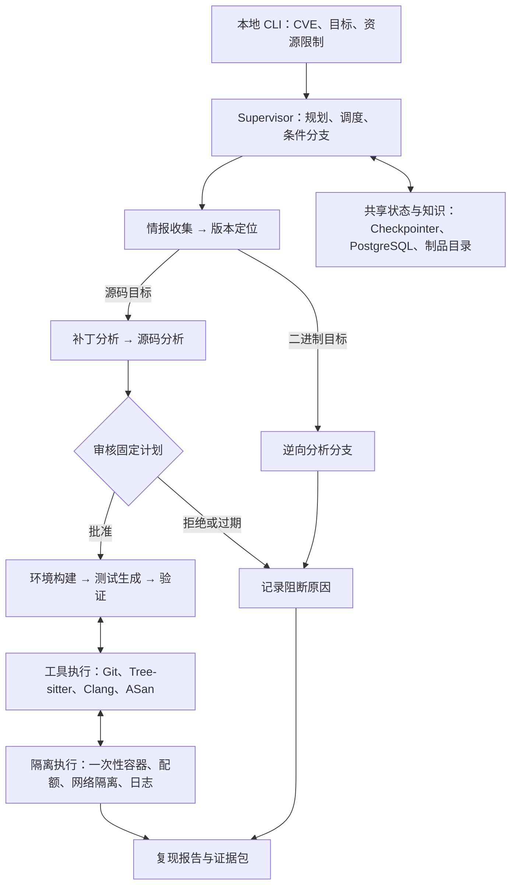

# 系统架构设计

## 主流程

Supervisor 通过 LangGraph 编排阶段，业务记录保存在 PostgreSQL，图检查点用于恢复位置，制品存储保留原始记录和大文件。情报快照可在准备阶段从获准来源获取或从本地导入。Git 解析、diff 与 Tree-sitter 读取不可信源码时由工具执行器使用独立的受限工具进程。构建和回放统一在断网环境运行。

## 技术栈与分层

- **输入层**。Python CLI 解析任务请求，提供审核、状态查询和证据导出。
- **编排层**。LangGraph Supervisor 按有向工作流调度八类 Agent。Python 类型化数据模型统一校验输入输出。节点责任与分支规则见 [多 Agent 协作设计](multi-agent-design.md)。
- **状态与知识层**。PostgreSQL 持久化业务状态和 LangGraph Checkpointer。本地内容寻址目录存原始制品。对象存储及向量检索沿存储接口扩展。
- **工具执行层**。Git、Tree-sitter、Clang/ASan 走受约束的适配器。CodeQL、Ghidra、AFL++、libFuzzer 通过独立适配器接入后续版本。
- **隔离层**。专用 Linux VM 承载执行器，Docker 提供一次性任务容器。VM 可扩展为单任务执行后端。
- **交付层**。确定性判定器生成报告，打包器导出证据和哈希清单。

## 状态与知识

- 业务表保存任务、状态版本、阶段截止时间、计划摘要、审核、工具尝试和制品引用。审计事件只追加。LangGraph Checkpointer 使用独立表及 `thread_id=job_id`，图状态存任务引用和调度位置。
- 恢复时以已提交的业务记录决定下一阶段。节点从数据库读取阶段和计划摘要，已完成步骤返回既有结果。审核请求在独立步骤落库后进入 `interrupt()`。恢复可能从节点开头重新执行，故审核挂起节点只读取已有审核记录；重复批准不得重新排队。 [LangGraph 持久化](https://docs.langchain.com/oss/python/langgraph/persistence) · [LangGraph 审核中断](https://docs.langchain.com/oss/python/langgraph/interrupts)
- MVP 使用本地内容寻址目录实现制品存储接口，报告与索引使用任务内逻辑路径。后续用同一接口接入对象存储。向量检索用于跨任务查找历史线索，检索结果保留来源并按授权范围过滤。
- 模型接在分析节点，接收经裁剪的公告和源码片段，只输出类型化建议。离线模式使用规则或测试替身。外部模型属于可选配置，生产配置明确选择可以送出的字段，默认只走本地/离线路径。

## 数据流与信任边界

1. CLI 写入任务和案例配置摘要。情报快照、Git diff、源码分析进入制品目录，图状态保留引用。
2. Supervisor 冻结计划，写入计划和审核请求。审批通过后，从业务记录读取授权快照，将固定材料挂入隔离执行器。
3. 执行器记录构建和回放结果，验证节点据此形成结论。归档器原子发布证据清单及报告，终态记录指向已封存的包。
4. 跨边界执行和制品收集由工具适配器负责。控制面保留审批与存储访问权限，目标进程只获取必要的材料和工作空间。见 [安全与执行环境设计](security-design.md)。

## 运行记录

用 `job_id`、`stage`、`step_key`、`attempt_no` 关联事件。记录输入摘要、策略版本、调用类型、耗时、退出状态、审核身份和结论原因；对摘要之外的敏感字段做脱敏。实验运行关注任务完成时长、隔离阻断数、重试率、复现结论分布及制品校验失败数。
