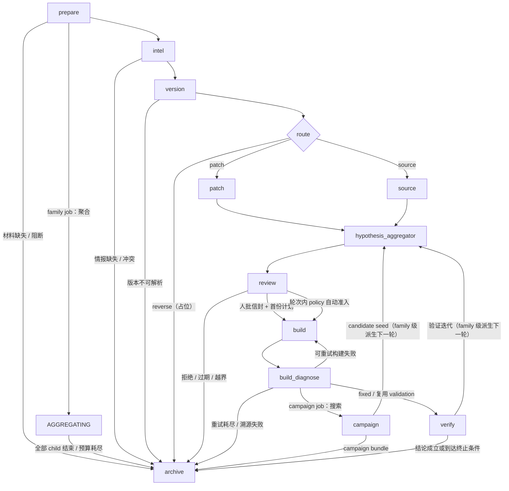

# DataCon v0.2 增量规范

**版本** v0.2  
**日期** 2026-11-21  
**状态** 已批准，改9 修订（T09 门禁改动保留；改7 的 T12 准入持久化、信封绑定、预算快照与审批账本初始化坐标保留；改8 的 T12 family 转移决策入口与坐标保留；改9 只补 T12 runtime 契约：固定 fuzz shim 与 guided `harness_digest` 绑定、campaign 每版 parser + fuzzer 两个构建产物、种子语料登记与摘要、corpus 超限细因、预算门禁/扣费与派生轮次“先 gate 后建 child”的准入接线，以及准入、阻断归档与扣费的崩溃恢复；不改 REQ/TC 编号，不新增 §10 原因码）  
**适用范围** 多轮探索、计划身份、自动准入、构建溯源与证据 v2

## 1. 版本声明

v0.2 是叠加在 v0.1 之上的增量规范，不是对 v0.1 的改写。v0.1 的十二份文档位于 [`docs/spec/`](../) 根目录，保持字节级冻结；本目录只新增十二份文件：

- [README.md](README.md)
- [adr/ADR-001-plan-identity-child-job.md](adr/ADR-001-plan-identity-child-job.md)
- [adr/ADR-002-exploration-envelope.md](adr/ADR-002-exploration-envelope.md)
- [adr/ADR-003-hypothesis-experiment-spec.md](adr/ADR-003-hypothesis-experiment-spec.md)
- [adr/ADR-004-budget-ledger.md](adr/ADR-004-budget-ledger.md)
- [adr/ADR-005-build-provenance.md](adr/ADR-005-build-provenance.md)
- [adr/ADR-006-evidence-v2-versioning.md](adr/ADR-006-evidence-v2-versioning.md)
- [srs-delta.md](srs-delta.md)
- [interface-contract-delta.md](interface-contract-delta.md)
- [security-design-delta.md](security-design-delta.md)
- [test-plan-delta.md](test-plan-delta.md)
- [tasks.md](tasks.md)

T09 只交付规范与 CI 门禁改动，不修改业务代码、数据库迁移、工作流、执行器、证据实现、示例或根 README。本目录中的“实现”均指 T10–T15 的后续工作。

## 2. 与 v0.1 的关系与冲突规则

| 情形 | 适用文本 |
| --- | --- |
| v0.2 delta 明确覆盖的条款 | 以 v0.2 为准 |
| v0.2 delta 未覆盖的条款 | 以 v0.1 为准，并继续冻结 |
| T10 及之后的新工作 | 以 v0.2 为准 |
| T10 落地前的既有行为 | 以 v0.1 为准 |
| v0.2 与 v0.1 的同一编号需求 | 编号不变，按 v0.2 修改条款执行 |

补充规则：

1. v0.2 不得回溯修改 v0.1 的任何文件；发现冲突时先更新 v0.2 delta，再按上表解释。
2. 既有 v0.1 任务、计划、审核与证据包只读兼容：可查询、可导出、可离线校验；不得用 v0.2 语义重跑或在线回填。
3. 未被 v0.2 覆盖的 v0.1 行为在 T10 落地前保持原实现；T10 的验收必须同时证明旧行为没有被破坏。
4. 本 README 的编排图是 T11 的验收出处；[架构设计](../architecture.md) 与 [多 Agent 协作设计](../multi-agent-design.md) 在 T09 不更新。
5. **v1 读取边界**。v1 控制面只承诺读取 v1 时代数据；回滚后 v2 终态证据由保留的 v2 只读 verifier/export 服务读取。不在 v1 代码中增加 v2 plan/evidence 解析。
6. **发布边界**。本轮 [CI/CD 规范](../ci-cd.md) 的 release smoke 与 B03 验收继续走 v1 兼容路径，发布 manifest 的 `contract_version` 保持 `1`；v2 发布 smoke 另立后续任务，不得静默混入 T13。这里的 `contract_version` 与 `jobs.job_contract_version`、证据 `schema_version` 是三个不同字段。

## 3. 文档地图

| v0.2 文档 | 覆盖的 v0.1 章节或主题 |
| --- | --- |
| [ADR-001](adr/ADR-001-plan-identity-child-job.md) | [接口契约](../interface-contract.md) 的 Job/Plan/Review；[SRS](../srs.md) REQ-03、REQ-04 |
| [ADR-002](adr/ADR-002-exploration-envelope.md) | [安全设计](../security-design.md) 的授权边界与审批；[接口契约](../interface-contract.md) 的审核记录 |
| [ADR-003](adr/ADR-003-hypothesis-experiment-spec.md) | [SRS](../srs.md) REQ-03、REQ-09；[多 Agent 协作设计](../multi-agent-design.md) 的分析 Agent |
| [ADR-004](adr/ADR-004-budget-ledger.md) | [SRS](../srs.md) REQ-01、REQ-04；[接口契约](../interface-contract.md) 的 Job/Attempt |
| [ADR-005](adr/ADR-005-build-provenance.md) | [SRS](../srs.md) REQ-06；[接口契约](../interface-contract.md) 的 Plan；[安全设计](../security-design.md) 的构建与回放 |
| [ADR-006](adr/ADR-006-evidence-v2-versioning.md) | [SRS](../srs.md) REQ-08；[接口契约](../interface-contract.md) 的证据包 |
| [srs-delta.md](srs-delta.md) | [SRS](../srs.md) 新增 REQ-11..16，修改 REQ-02/03/06/07/08/09 |
| [interface-contract-delta.md](interface-contract-delta.md) | [接口契约](../interface-contract.md) 全部结构的 v0.2 增量 |
| [security-design-delta.md](security-design-delta.md) | [安全设计](../security-design.md) 的授权、执行、威胁与验收 |
| [test-plan-delta.md](test-plan-delta.md) | [测试与评估计划](../test-plan.md) 的追踪、分层、基准与 CI 约束 |
| [tasks.md](tasks.md) | [开发任务清单](../tasks.md) 的 T09–T15 拆分 |

## 4. REQ/TC 编号规则

- v0.1 需求编号为 REQ-01..REQ-10，测试用例编号为 TC-01..TC-10，均已冻结。
- v0.2 新增需求从 REQ-11 起，新增测试用例从 TC-11 起；TC-11..TC-16 与 REQ-11..REQ-16 一一对应。
- 修改需求保留原编号：REQ-02、REQ-03、REQ-06、REQ-07、REQ-08、REQ-09。不得为新语义分配新编号，也不得复用已废弃编号。
- v0.2 不新增 TC-11..16 以外的用例编号；TC-02/03/06/07/08/09 在 v0.2 只重定范围并保留 v0.1 断言。
- 本目录可引用 REQ-01..REQ-16 与 TC-01..TC-16；v0.1 根目录文档只能引用 01..10；根 README、`tests/` 笔记与 `docs/` 其他文件可引用并集 01..16。
- 门禁按文件相对仓库根的位置选择允许集合，集合有明确上界，不做开放式编号放行。规则与用例见 [test-plan-delta.md](test-plan-delta.md)。

## 5. 目标编排图（T11 验收出处）

T11 必须实现下图中的节点名称与边；节点内部语义以本目录的 REQ 与接口为准。图中 `route` 的 `reverse` 分支是占位分支，当前只允许归档 `UNSUPPORTED_TARGET`。`AGGREGATING` 是 family job 的聚合分支，不是 round 节点。

### 节点

| 节点 | 责任 | 禁止事项 |
| --- | --- | --- |
| `prepare` | 恢复任务、校验请求与预算、建立或恢复 family 聚合记录 | 不重跑已完成的子轮次 |
| `AGGREGATING` | family job 的聚合分支：收集 child 终态、预算与导出索引，等待全部 child 结束 | 不可领取，不得用 `RUNNING` 表示聚合 |
| `intel` | 采集或读取不可变情报快照，记录来源、时间与摘要 | 不把外部文本当指令 |
| `version` | 解析缺陷版与修复版完整 Git 对象 ID，固定补丁与依赖 | 不自行选择新版本 |
| `route` | 按目标类型路由到 `patch`、`source` 或 `reverse` 占位 | 二进制分支不进入构建 |
| `patch` | 由补丁事实产生候选根因与证据引用 | 不产生判定 |
| `source` | 由源码结构产生候选符号、调用点与证据引用 | 不执行模型生成代码 |
| `hypothesis_aggregator` | 汇总模型 hypothesis，产出候选 `ExperimentSpec` | 不扩大信封，不合成 fuzz harness |
| `review` | 首份计划由人批准信封与计划（campaign 或 fixed round）；轮次内由 policy 自动准入 | policy 不写 `reviews` |
| `build` | 按计划构建两版，或复用 campaign 的已构建制品 | 不重复构建已复用制品 |
| `build_diagnose` | 核对构建溯源与生效编译参数，决定重试、继续或归档 | 不以未核对的 recipe 文本代替生效参数 |
| `campaign` | campaign child：构建一次双版本并做 fuzz 搜索，产出 candidate seed 与 campaign bundle；不产 verdict | 不进入六次回放判定，不替代 validation |
| `verify` | 六次回放、确定性判定、证据归档 | 不使用普通退出码或模型推测出结论 |
| `archive` | 归档 v2 证据；family 导出与 campaign 审计 | 不修改已封存证据 |

### 完整边集

下表覆盖 Mermaid 图中的每一条边，T11 的边集测试以本表为准。

| # | 边 | 条件 | 循环上限与说明 |
| --- | --- | --- | --- |
| 1 | `prepare → intel` | 普通 child 计划路径 | 单次进入 |
| 2 | `prepare → AGGREGATING` | 当前 job 为 `job_kind=family` | family 只聚合，不执行 build/replay |
| 3 | `prepare → archive` | 材料缺失、请求非法或准备阶段阻断 | 保留原因码 |
| 4 | `AGGREGATING → archive` | 全部 child 结束、预算耗尽或收到终止条件 | family 终态汇总后归档 |
| 5 | `intel → version` | 快照可用且无来源冲突 | 单次进入 |
| 6 | `intel → archive` | 快照缺失或来源冲突 | `MATERIAL_MISSING` / `SOURCE_CONFLICT` |
| 7 | `version → route` | 两版完整 Git 对象 ID 已解析 | 单次进入 |
| 8 | `version → archive` | 版本不可解析或时限耗尽 | 保留已有证据 |
| 9 | `route → patch` | 目标类型为补丁 | 单次进入 |
| 10 | `route → source` | 目标类型为源码 | 单次进入 |
| 11 | `route → archive` | `reverse` 占位或二进制目标 | `UNSUPPORTED_TARGET` |
| 12 | `patch → hypothesis_aggregator` | 产生候选根因与证据引用 | 不产生判定 |
| 13 | `source → hypothesis_aggregator` | 产生候选符号与调用点 | 不产生判定 |
| 14 | `hypothesis_aggregator → review` | 产出候选 `ExperimentSpec` | 不扩大信封 |
| 15 | `review → build`（首份计划） | 人批准信封与首份计划（campaign 计划或 fixed round 1 计划） | 仅一次人批；换信封必须重新人批 |
| 16 | `review → build`（轮次内） | policy 准入通过，且 `admissions` 已落库 | 每轮一条 admission；不写 review |
| 17 | `review → archive` | 拒绝、过期或越界 | 终态不可回退 |
| 18 | `build → build_diagnose` | 两版构建完成或复用校验完成 | 单次进入 |
| 19 | `build_diagnose → build` | 构建诊断判定为可重试的基础设施或材料可修复失败 | 每个逻辑构建步骤最多额外重试一次 |
| 20 | `build_diagnose → campaign` | 当前 job 为 `job_kind=campaign`，构建通过后进入 fuzz 搜索 | campaign 只产 campaign bundle 与 candidate seed，不产 verdict |
| 21 | `build_diagnose → verify` | fixed 模式或复用 validation | 进入六次回放 |
| 22 | `build_diagnose → archive` | 重试耗尽或溯源失败 | 归档 `BUILD_FAILED` 或 `BUILD_PROVENANCE_MISSING` |
| 23 | `campaign → hypothesis_aggregator` | guided 模式产生下一轮候选 seed | family 级逻辑转移：派生新的 `job_kind=round` child；当前 campaign child 自己完成 `archive`，不得原地继续跑 verify |
| 24 | `campaign → archive` | campaign 搜索结束或到达 fuzz 预算 | 保存 campaign bundle，供 family 审计；campaign 完成且无候选 seed 时，runtime 在 campaign 决策点（`after_round_no=0`）记录 `no_next_round`（`NO_CANDIDATE_SEED`）后 family 归档，无决策则保持 `AGGREGATING`（改8） |
| 25 | `verify → archive` | 结论为 `REPRODUCED`、`NOT_REPRODUCED`，或到达终止条件 | 终态不可回退 |
| 26 | `verify → hypothesis_aggregator` | 六次回放未形成结论，且仍有 `max_rounds` 与预算余额 | family 级逻辑转移：派生下一轮 child；受 `max_rounds`、`max_total_seconds`、`max_fuzz_seconds` 与账本约束，耗尽归档 `BUDGET_EXHAUSTED`；仍有轮次与预算但 seed 已用尽时，runtime 在第 k 轮决策点（`after_round_no=k`）记录 `no_next_round`（`NO_REMAINING_SEEDS`）后 family 归档（改8） |

两条 family 级转移（#23、#26）不是同一 job 内的继续执行：当前 child 必须先自行 `archive`，再由 family 创建下一轮 child。family 的多个 child 串行执行，同一时刻只有一个执行槽位。

**family 转移决策（改8）**。campaign 完成且无候选 seed 时，runtime 记录 `no_next_round` 决策后 family 归档；无决策保持 `AGGREGATING`。决策按决策点记录：`after_round_no=0` 是 campaign 归档后的决策点（边 #23/#24），`after_round_no=k`（k ≥ 1）是第 k 轮以 `INCONCLUSIVE` 归档后的决策点（边 #26），因此“有 seed 但跑完 k 轮后 seed 用尽”的 family 同样可以收敛。归档判定只采纳当前 campaign 在当前决策点（`after_round_no` 等于已用轮次）的 `no_next_round`；`next_round`、历史决策点或不匹配的决策都不触发归档。决策只以 family 的 `family_transition_decided` 审计事件为准，入口与字段见[接口 §9.2](interface-contract-delta.md)。

**终态说明（D40）**。campaign child 在搜索结束或 fuzz 预算耗尽并完成归档后，job `state=COMPLETED`；family 在聚合期间保持不可领取的 `AGGREGATING`，聚合归档后同样 `state=COMPLETED`。`COMPLETED` 是 v2 新增终态：`verdict`/`reason_code` 为 null，`evidence_status='archived'`，`claim_next` 不领取，回滚排空集合不包含它。campaign 不再用 `INCONCLUSIVE` 表示“搜索完成”；`INCONCLUSIVE` 只表示复现判定未形成结论。archive 节点对 campaign 与 family 的归档动作不变，变的只是归档后的 job 终态。

**family 归档索引（D43 补充 D40）**。family 聚合归档时落盘 `family.json` 作为 family index，job `state=COMPLETED`、`evidence_status='archived'`，`evidence_path` 指向该文件、`evidence_digest` 为其 SHA-256；Mermaid 节点与边集不因该归档物改变。

T11 的验收必须覆盖：节点名与边可枚举并与本表逐条一致、`build_diagnose` 重试只发生一次且耗尽后归档、campaign 分支可挂载、family `AGGREGATING` 分支存在、family child 串行、节点重入为 no-op。policy 准入不写 `reviews` 的行为由 T12 验收，T11 只保证图中 `review → build` 的 policy 边存在。

## 6. 决策登记索引

| 决策 | 落点 |
| --- | --- |
| D1 一轮 = 一个 child job | [ADR-001](adr/ADR-001-plan-identity-child-job.md) |
| D2 campaign/validation 复用与 `build_ref` | [ADR-001](adr/ADR-001-plan-identity-child-job.md)、[ADR-006](adr/ADR-006-evidence-v2-versioning.md) |
| D3 validation 证据自包含 | [ADR-006](adr/ADR-006-evidence-v2-versioning.md) |
| D4 构建记录不含 input 摘要 | [ADR-005](adr/ADR-005-build-provenance.md)、[ADR-006](adr/ADR-006-evidence-v2-versioning.md) |
| D5 信封字段 | [ADR-002](adr/ADR-002-exploration-envelope.md) |
| D6 人批信封与 policy 准入 | [ADR-002](adr/ADR-002-exploration-envelope.md) |
| D7 `envelope_digest` 进全部 v2 plan | [ADR-001](adr/ADR-001-plan-identity-child-job.md)、[ADR-002](adr/ADR-002-exploration-envelope.md) |
| D8 准入离线可重算 / 不可重算准入标注 | [ADR-002](adr/ADR-002-exploration-envelope.md)、[interface-contract-delta.md](interface-contract-delta.md) 第 6 节、[security-design-delta.md](security-design-delta.md) 第 6 节 |
| D9 crash seed 固化与六回放 | [srs-delta.md](srs-delta.md) REQ-07、[security-design-delta.md](security-design-delta.md) 第 5 节 |
| D10 harness 冻结 | [ADR-002](adr/ADR-002-exploration-envelope.md)、[security-design-delta.md](security-design-delta.md) |
| D11 ExperimentSpec | [ADR-003](adr/ADR-003-hypothesis-experiment-spec.md) |
| D12 预算账本 | [ADR-004](adr/ADR-004-budget-ledger.md) |
| D13 BuildSpec 与生效参数 | [ADR-005](adr/ADR-005-build-provenance.md) |
| D14 工具链边界 | [ADR-005](adr/ADR-005-build-provenance.md) |
| D15 证据版本分派 | [ADR-006](adr/ADR-006-evidence-v2-versioning.md) |
| D16 campaign bundle 与 family 导出 | [ADR-006](adr/ADR-006-evidence-v2-versioning.md) |
| D17 证据引用语法 | [interface-contract-delta.md](interface-contract-delta.md) |
| D18 REQ-11..16 与修改 REQ | [srs-delta.md](srs-delta.md) |
| D19 TC-11 起一一对应 | [test-plan-delta.md](test-plan-delta.md) |
| D20 冲突规则 | 本 README 第 2 节 |
| D21 目标编排图 | 本 README 第 5 节 |
| D22 job 身份与 `job_contract_version` | [ADR-001](adr/ADR-001-plan-identity-child-job.md)、[interface-contract-delta.md](interface-contract-delta.md) 第 7 节 |
| D23 父审批摘要与 `family_approvals` | [ADR-001](adr/ADR-001-plan-identity-child-job.md)、[ADR-002](adr/ADR-002-exploration-envelope.md) |
| D24 排空/静默回滚围栏 | [ADR-001](adr/ADR-001-plan-identity-child-job.md)、[interface-contract-delta.md](interface-contract-delta.md) 第 7 节 |
| D25 证据角色全集 | [ADR-006](adr/ADR-006-evidence-v2-versioning.md)、[interface-contract-delta.md](interface-contract-delta.md) 第 8 节 |
| D26 信封 mutation 上限 | [ADR-002](adr/ADR-002-exploration-envelope.md)、[interface-contract-delta.md](interface-contract-delta.md) 第 2 节 |
| D27 统一签名结构 | [ADR-002](adr/ADR-002-exploration-envelope.md)、[ADR-003](adr/ADR-003-hypothesis-experiment-spec.md) |
| D28 B04-A / B04-H | [ADR-003](adr/ADR-003-hypothesis-experiment-spec.md)、[test-plan-delta.md](test-plan-delta.md) 第 4 节 |
| D29 单执行槽位 | [ADR-004](adr/ADR-004-budget-ledger.md)、[tasks.md](tasks.md) |
| D30 AgentOutput v2 | [ADR-003](adr/ADR-003-hypothesis-experiment-spec.md)、[interface-contract-delta.md](interface-contract-delta.md) 第 4 节 |
| D31 BuildSpec 统一与 compile_flags 顺序 | [ADR-005](adr/ADR-005-build-provenance.md)、[interface-contract-delta.md](interface-contract-delta.md) 第 5 节 |
| D32 账本 charges 与 `max_rounds` | [ADR-004](adr/ADR-004-budget-ledger.md)、[interface-contract-delta.md](interface-contract-delta.md) 第 7 节 |
| D33 status 与 family `AGGREGATING` | [interface-contract-delta.md](interface-contract-delta.md) 第 9 节、本 README 第 5 节 |
| D34 编排图完整边集 | 本 README 第 5 节 |
| D35 发布与 v1 读取边界 | 本 README 第 2 节、[ADR-006](adr/ADR-006-evidence-v2-versioning.md)、[tasks.md](tasks.md) T13 |
| D36 审核状态同步与锁顺序 | [ADR-001](adr/ADR-001-plan-identity-child-job.md)、[ADR-002](adr/ADR-002-exploration-envelope.md)、[interface-contract-delta.md](interface-contract-delta.md) 第 9.1 节 |
| D37 marker 组契约 | [test-plan-delta.md](test-plan-delta.md) 第 5 节第 6 条、[tasks.md](tasks.md) T12/T13 |
| D38 release 解耦、回滚门禁与迁移编号 | [interface-contract-delta.md](interface-contract-delta.md) 第 7 节（迁移编号与门禁）、[tasks.md](tasks.md) T10（迁移编号与门禁）、[ADR-006](adr/ADR-006-evidence-v2-versioning.md)（仅覆盖发布边界） |
| D39 evidence 路径统一 | [interface-contract-delta.md](interface-contract-delta.md) 第 8 节、[ADR-006](adr/ADR-006-evidence-v2-versioning.md) |
| D40 campaign 与 family 终态 `COMPLETED` | [interface-contract-delta.md](interface-contract-delta.md) 第 7/9 节、[ADR-001](adr/ADR-001-plan-identity-child-job.md)、[ADR-006](adr/ADR-006-evidence-v2-versioning.md)、本 README 第 5/7 节 |
| D41 三个数据模型边角 | [interface-contract-delta.md](interface-contract-delta.md) 第 3/5/7 节、[ADR-001](adr/ADR-001-plan-identity-child-job.md)、[ADR-004](adr/ADR-004-budget-ledger.md)、[ADR-005](adr/ADR-005-build-provenance.md) |
| D42 审核重批的信封身份与幂等键 | [interface-contract-delta.md](interface-contract-delta.md) 第 9/9.1 节、[ADR-001](adr/ADR-001-plan-identity-child-job.md)、[ADR-002](adr/ADR-002-exploration-envelope.md)、[tasks.md](tasks.md) T10、[test-plan-delta.md](test-plan-delta.md) T10 |
| D43 family 归档索引与 `COMPLETED` 证据指针 | [interface-contract-delta.md](interface-contract-delta.md) 第 7/8/9 节、[ADR-001](adr/ADR-001-plan-identity-child-job.md)、[ADR-006](adr/ADR-006-evidence-v2-versioning.md)、[tasks.md](tasks.md) T10（白名单与 007 兼容）/T12（`family.json` 落盘与导出）、[test-plan-delta.md](test-plan-delta.md) T12 |
| D44 在线情报抓取与快照边界 | [security-design-delta.md](security-design-delta.md) 第 3 节、[srs-delta.md](srs-delta.md) REQ-02、[tasks.md](tasks.md) T15、[test-plan-delta.md](test-plan-delta.md) T15 |

## 7. 不变量

1. 一轮只对应一个 child job；父 job 只聚合，不重复执行轮次；family 的 child 串行执行。
2. 人只批准信封与首份计划；换信封产生新 approval 并以 `supersedes` 指向旧 approval；轮次内准入写 `admissions`，不写 `reviews`。
3. `envelope_digest` 进入 v2 execution/campaign plan；fixed 的退化信封同样非空；`mutation_limits` 是信封正文的一部分并进入摘要。信封正文不内联进 `plan_digest`，但绑定关系不能因此缺失。`build_ref` 只在复用 campaign 的 validation plan 中非空；证据中的 `reuse_origin` 同条件非空。fixed/non-reuse 两者为 null。
4. 模型只产 hypothesis 与 `ExperimentSpec`；模型来源 finding 只允许 `kind=hypothesis`，确定性工具事实不经模型出口；假设不改变判定。
5. fuzz harness 与 build recipe 同级冻结；模型合成后不得直接执行。
6. crash seed 固化字节与 SHA-256，并回主镜像完成六次回放才允许出结论。复用 campaign 构建的 guided validation 轮（`reuse_origin` 非空）回放的是 campaign crash seed，其 clean 输出未登记，故该轮 candidate 的 clean 判定只看 `expected_exit.candidate_clean` 与无 ASan 诊断，不比 `expected_stdout.candidate_clean`；normal 对照与其余优先级规则不变，`rule.checks.candidate_stdout_checked` 记录所用策略（改9 增补；fixed 与 v1 判据不变）。
7. 预算以 family 级原子行扣减，任何路径不得透支；幂等键为 `(job_id, step_key, attempt_no)`，恢复同一 attempt 不重复记账，重试新 attempt 新扣费；fuzz 子预算单独对账。
8. 构建溯源判据是“声明 ⊆ 生效（多重集包含），且两版生效有序序列严格相等”；`-I a -I b` 与 `-I b -I a` 不相等；没有核对面时在冻结计划阶段失败。
9. v1 证据只读兼容；v2 校验按 `manifest.schema_version` 分派；v1 分支不得调用新实现。v1 控制面只读 v1 时代数据，v2 终态证据由 v2 只读 verifier/export 读取。
10. 每个轮次证据包可独立离线校验；campaign bundle 单独归档供 family 审计。
11. D4 只约束 v2；v1 构建记录继续保留 `inputs/normal.txt` 与 `inputs/candidate.txt` 两个别名，既有 v1 包不改写。
12. campaign 是 family 下的特殊 child（`job_kind=campaign`、`round_no=null`），不产 verdict；validation round 通过 `build_ref` 复用它。
13. 回滚采用排空/静默：v1/v2 worker 不得在有 v2 非终态 job 时共享队列；回滚到 v1 前必须排空 `QUEUED`、`PREPARING`、`AWAITING_REVIEW`、`AGGREGATING`、`READY`、`RUNNING`、`ARCHIVING` 与 `BLOCKED` 且 `workflow_synced=false` 的 v2 job。本版不引入独立队列表；CHECK 只防脏数据，不能防旧 worker 误领。
14. family job 使用不可领取的 `AGGREGATING` 状态，不得用 `RUNNING` 表示聚合；`admission_kind` 是派生字段，首份计划为 `human`、轮次内为 `policy`、无决议为 null。
15. 证据角色 = v0.1 完整 27 个角色 + v0.2 新增 13 个角色；v2 `execution` 恰好包含 `review` 或 `admission` 之一，validation 必须带 `envelope` 与 `budget_snapshot`。
16. **审核锁序**。`record_review` 与 `expire_review` 一律先锁 family、再锁首份 child，换信封重批只锁 family，超时在同一事务内收敛 child 与 family。审核对象、完整状态迁移与锁序以[接口 §9.1](interface-contract-delta.md) 为准，本节不重抄。
17. **`COMPLETED` 终态与无租约收敛**。campaign 与 family 归档后 `state=COMPLETED`，`verdict`/`reason_code` 为 null、`evidence_status='archived'`；`finish_execution` 仅用于持有有效 worker lease 且处于 `RUNNING`/`ARCHIVING` 的 child job（含 `campaign` child 落 `COMPLETED`），family 则由无执行租约的 `complete_family(family_id, evidence_path, evidence_digest)` 从 `AGGREGATING → COMPLETED` 收敛（仍受 007 `jobs_archived_evidence_check` 约束，且具备崩溃恢复扫描幂等补收敛路径）。`claim_next` 不领取 `COMPLETED`，回滚排空集合不包含它。v1 终态枚举不变。（由 D43 补充：family 归档必须落 `family.json` 并提供非空证据指针。）
18. **预算最小值与扣减协议**。`budget_ledger` 约束 `max_total_seconds > 0`、`max_fuzz_seconds >= 0`、`max_fuzz_seconds <= max_total_seconds`、`remaining_total_seconds <= max_total_seconds`、`remaining_fuzz_seconds <= max_fuzz_seconds` 与两个 `remaining_* >= 0`，禁止增加 `remaining_fuzz_seconds <= remaining_total_seconds` 的交叉 CHECK；DB 列 `remaining_total_seconds` 对应 JSON `remaining_seconds`。执行采用唯一协议（见[接口 §7](interface-contract-delta.md)）：启动前按 `min(remaining_total_seconds, remaining_fuzz_seconds)` 校验并下发容器硬超时，容器退出后在独立短事务内原子扣减并落账，任一不足即 `BUDGET_EXHAUSTED`。
19. **编译参数等价**。`declared_compile_flags` 与生效参数比较前走同一归一化（封闭 7 项集合 `{-I, -L, -l, -D, -U, -isystem, -include}`，规范形态与多编译单元规则见[接口 §5](interface-contract-delta.md)），不改变顺序；`-I a -I b` 与 `-I b -I a` 仍必须不相等。
20. **重批信封身份与五元组校验顺序**。`review` 的待审对象由 `family_envelopes` 承载（带 `review_deadline_at`，每个 family 至多一个 `status='pending'`）；`--envelope-digest` 在首轮人批可省略并解析为首份 plan 的 `envelope_digest`，换信封重批必填（须先经 `propose-envelope` 提交）。幂等键为五元组 `(family_id, first_plan_digest, envelope_digest, decision, reviewer_id)`，处理顺序严格为：① 先校验 `--plan-digest == first_plan_digest`（不符即拒绝，不写任何行）；② 按 `(family_id, envelope_digest)` 查 `family_envelopes`，若为 `approved`/`rejected` 则匹配五元组返回 `idempotent` 否则返回 `conflict`，若为 `expired` 则返回 `expired`；③ 仅当记录不存在或非当前 `pending`（含首轮显式摘要与首份 plan 不符）时返回 `REVIEW_ENVELOPE_MISMATCH`，均不新增行（完整状态表见[接口 §9.1](interface-contract-delta.md)）。
21. **family 归档索引与 `COMPLETED` 证据指针**。family 归档落盘 `family.json`（`kind="family_index"`，不是 v2 evidence bundle，不新增角色或 `bundle_kind`），其 `rounds[]`、`campaign`、`budget` 与 `family_approval_digest` 构成 family 索引；`jobs.evidence_path` 指向该文件、`evidence_digest` 为其 SHA-256、`evidence_status='archived'`，`state=COMPLETED` 不得用空指针绕过 `jobs_archived_evidence_check`。`export --family` 根目录的 `family.json` 与归档件字节一致，不重写单轮 manifest。

## 8. 验收与门禁

T09 门禁在改8 后仍应满足：

- `python -m datacon.ci_gates --root .` 返回 `ok: true`，`errors` 为空，`checked_markdown` 为 27（仓库其余 15 份 + 本目录 12 份，且集合包含本目录 12 份）。
- `tests/contract/test_ci_gates.py` 43 项全绿，其中包含四条路径作用域用例。
- 改6 只改本目录的 Markdown，不触及业务代码、工作流、迁移、`scripts/`、`examples/`、根 README 或 v0.1 文档；`git status --short` 只出现未跟踪的 `docs/spec/v0.2/`（默认折叠；使用 `-uall` 时列出本目录 12 个文件）与两个保留的 T09 门禁改动 `src/datacon/ci_gates.py`、`tests/contract/test_ci_gates.py`（均显示为 `M`，不新增其他改动）。
- 改7 只登记 T12 准入持久化坐标、预算快照幂等冲突坐标、审批/计划信封绑定坐标、审批初始化预算账本坐标与三路径语义，不改变 REQ/TC、§10 原因码或行为契约。
- 改8 增补 family 转移决策入口与坐标（`record_family_transition_decision`、T12 的 `postgres` 坐标与边 #24/#26 的说明），不改变 REQ/TC 与 §10 原因码；决策子码 `NO_CANDIDATE_SEED`/`NO_REMAINING_SEEDS` 只出现在决策审计的 `detail.reason_code`，不进入 `jobs.reason_code`、审计 `reason_code` 列或 §10 终态封闭集。
- 改9 只补 T12 runtime 契约（[接口 §2/§5/§7/§8/§10](interface-contract-delta.md)、[安全 §5](security-design-delta.md)）与 A 阶段坐标，不改变 REQ/TC 编号与 §10 原因码；corpus 超限细因 `CORPUS_TOTAL_BYTES_EXCEEDED`/`CORPUS_FILE_BYTES_EXCEEDED`/`CORPUS_FILE_COUNT_EXCEEDED` 只出现在审计 `detail.sub_reason`，顶层归 `POLICY_DENIED`；B（campaign fuzz runtime）与 C（guided validation 复用）阶段坐标在其落地 PR 中登记。
- 本目录所有相对链接可解析，REQ/TC 引用落在允许集合内；六份 ADR 文件总行数（含空行）60–120 行，含标题、Status、Date 与 6 个二级节。
- 不新增 `xfail`、`skip` 或业务代码；T09 不新增 T10–T15 的测试代码，仅新增四条门禁作用域用例；各任务开工时再按坐标创建测试。
